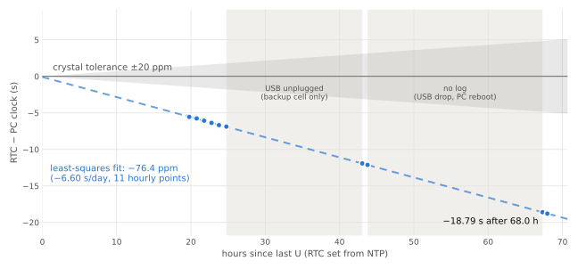

# Results: reference board, 2026-10-27 to 2026-10-30

SJWCH1302Q-W + SJK-7L32768KDY2400A8 (32.768 kHz, CL 12.5 pF) on an ESP32-C5,
RTC supplied from 3.3 V with a backup cell, room temperature, bench WiFi.
Method and limits: [`../docs/BENCHMARK.md`](../docs/BENCHMARK.md).

Labels: **M** = measured on this board, **D** = datasheet, **C** = calculated.
Logs: [`2026-10-27_run1.txt`](2026-10-27_run1.txt) and
[`2026-10-27_run2.txt`](2026-10-27_run2.txt). Each line carries the PC
timestamp (NTP-synced host).

## Summary

| # | Test | Limit | Run 1 | Run 2 | Verdict |
|---|---|---|---|---|---|
| 1 | Register sanity | all valid | PASS | PASS | PASS |
| 2 | Write protect | blocks / allows | PASS | PASS | PASS |
| 3 | Bus integrity, offline | 0 errors | 210 errors, all RAM 8 | 210, all RAM 8 | **FAIL** (RAM 8) |
| 4 | RAM addresses independent | 31/31 | — | 29/31 (7 → 8 coupled) | **FAIL** |
| 5 | Bus integrity, RF stress | 0 errors | 210, all RAM 8 | 210, all RAM 8 | **FAIL** (RAM 8) |
| 6 | Clock burst reads (2 × 3000 per run) | 0 errors | 0 | 0 | PASS |
| 7 | Tick test offline (120 ticks) | 0 missed, ≤ 1000 µs | 0 missed, max 37.7 µs | 0 missed, max 38.6 µs | PASS |
| 8 | Tick test RF stress (120 ticks) | 0 missed, ≤ 1000 µs | 0 missed, max 185.7 µs | 0 missed, max 158.9 µs | PASS |
| 9 | RF stress rate shift | ≤ ±2 ppm | +1.23 ppm | +0.93 ppm | PASS |
| 10 | RTC accuracy, 27 h (`C`) | ≤ ±20 ppm | −78.00 ± 1.10 ppm | −78.05 ± 1.95 ppm | **FAIL** |
| 11 | RTC accuracy, 10 min (`B`) | ≤ ±20 ppm | −61.8 ± 7.7 ppm | −67.4 ± 26.9 ppm | **FAIL** (screen only, see §3) |
| 12 | Oscillator start-up (5 runs) | ≤ 1000 ms | — | 102.6 / 108.4 / 115.0 ms min/avg/max | PASS |
| 13 | Calendar rollovers | 10/10 | — | 10/10 | PASS |
| 14 | Time restore after `D` | ≤ ±2 ms | — | +29.2 µs | PASS |
| 15 | Soak counters (`rd_err`, `jumps`, `stalls`, `glitch`) | 0 | 0 | 0 | PASS |

## 1. Accuracy (M)

### Long term: the reference number
`C` compares the RTC phase against NTP and against the phase at the last
update (26-10-2026 11:06:17 IST). That update was made by an earlier firmware
whose write was aligned by SNTP, so its phase is taken as 0 ± 100 ms; that
term dominates the ± values.

| Time (IST) | Since update | RTC − UTC | NTP round trip | Rate |
|---|---|---|---|---|
| 27-10 12:13 | 25.13 h | −7 s (1 s readout, earlier firmware) | — | −77.4 ppm |
| 27-10 14:08 | 27.03 h | −7590.3 ± 6.6 ms | 13.1 ms | **−78.00 ± 1.10 ppm** |
| 27-10 14:26 | 27.34 h | −7683.1 ± 91.8 ms | 183.5 ms | −78.05 ± 1.95 ppm |

That is **−6.74 s/day**, or about −3.4 min per month without network
updates. The interval includes a night with USB unplugged (running on the
backup cell). An earlier, coarser measurement over 62.9 h gave about
−75 ppm (−17 s against the PC clock).

**Continuity check (M).** After `D` had halted the oscillator five times and
rewritten the calendar ten times, `C` read −7683.1 ms. The earlier −7662.8 ms
plus 264 s at −78 ppm predicts −7683.4 ms.

### Rate against the ESP32 crystal (M)
This is very repeatable, with no NTP involved:

| | Run 1 | Run 2 |
|---|---|---|
| Offline (radio off) | −75.42 ± 0.11 ppm | −75.12 ± 0.11 ppm |
| WiFi RF stress | −74.19 ± 0.23 ppm | −74.19 ± 0.19 ppm |
| Shift | +1.23 ppm | +0.93 ppm |
| Die temperature during run | 28.2 → 33.2 °C | 27.2 → 33.2 °C |

Combining −78.0 ppm (RTC vs UTC, 27 h) with −75.1 to −75.4 ppm (RTC vs ESP32)
puts the ESP32-C5 crystal at about −2.7 ppm (C, assumes the RTC rate is
constant).

The RF shift is the RTC and ESP32 crystal together, while the module warmed by
≈ 5 °C. Below 2 ppm it is not attributable to RF coupling into the RTC crystal.

### Why the 10-minute accuracy test is only a screen (M)

| | Run 1 | Run 2 |
|---|---|---|
| Best NTP round trip | 12.1 ms | 172.9 ms |
| Offset fit rms | 3.03 ms | 10.26 ms |
| ESP32 crystal vs NTP | +12.44 ppm | +6.83 ppm |
| RTC vs UTC | −61.8 ± 7.7 ppm | −67.4 ± 26.9 ppm |

The RTC-vs-ESP32 rate repeated to 1 ppm, but the ESP32-vs-NTP slope did not.
Over 10 minutes, WiFi path delays wander by several ms, which is enough to
move the slope by 5–15 ppm. Both runs still flag the RTC as far outside
±20 ppm, which is all the screen is for. In run 2 the line "13 missed" counts
edges that were not captured while slow NTP bursts ran; they were not RTC
misses. The release firmware labels them "not captured while NTP ran".

## 2. Tick stability (M)
- Offline, 2 × 120 ticks: jitter 21.0 to 21.4 µs rms, max 37.7 to 38.6 µs.
  That equals the capture window of the 75 µs register read (±37 µs), so the
  real RTC jitter is below the measurement resolution.
- Under RF stress the maximum rises to 159 to 186 µs. That comes from WiFi
  interrupts delaying the capture loop, not from the RTC (rms 36 to 43 µs, no
  missed ticks).
- No missed or double ticks in 480 tick-test seconds.
- `[STAT]` soak counters stayed at 0 throughout.

## 3. Oscillator, calendar, write timing (M)

| Item | Result |
|---|---|
| Oscillator stops on CH = 1 | yes, all 5 runs |
| Start-up after CH = 0 | 104.0, 106.6, 113.8, 102.6, 115.0 ms |
| Calendar: midnight + DOW 7→1, hour carry, 30/04, 28/02/2027, 28/02/2028, 29/02/2028, 31/12, 2099→2000, 12 h AM→PM, 12 h PM→AM | all PASS |
| Countdown chain reset on seconds write | confirmed: restore landed +29.2 µs from target |

The crystal's ESR (70 kΩ max, D) is above the DS1302's 45 kΩ spec (D), yet
start-up is about 110 ms. That shows a comfortable oscillation margin at room
temperature and 3.3 V. It does not replace the series-resistor margin test.

## 4. RTC RAM (M)
- Writes to RAM address 8 are ignored. Reading RAM 8 returns RAM 7.
  Writing RAM 7 therefore "changes" RAM 8.
- The other 29 addresses are independent and store all 20 patterns.
- Burst RAM transfers are affected the same way at byte 8.
- The register dumps taken earlier with ErriezDS1302 also show bytes 7 and 8
  equal, so this is the chip, not the driver.

The DS1302 datasheet specifies 31 independent bytes (D). **Usable RAM on this
part: 30 bytes; do not use address 8.**

## 5. Bus and driver (M)

| Item | Value |
|---|---|
| 1-byte register read, own driver | 74.8 µs (offline), 80.6 to 81.1 µs (RF stress) |
| 8-byte clock burst read | 263.4 µs |
| `gpio_set_direction()` in + out | 5.70 µs |
| `gpio_config()`, i.e. `pinMode()` | 12230.5 µs |
| `rtc_gpio_deinit()` on GPIO4 | 12203.5 µs |
| Transfer with a `pinMode()`-based driver (2 calls) | ~24.5 ms |

Arduino-ESP32 3.3.8, ESP32-C5. Before switching to its own driver, this
firmware measured 24.5 ms per seconds-register poll with ErriezDS1302.

## 6. Temperature and conditions not tested (C)

The crystal's temperature curve, added to the measured −78 ppm bias
(details in [`../docs/HARDWARE.md`](../docs/HARDWARE.md#temperature-calculated-not-measured)):

| Temperature | Expected total | Per day |
|---|---|---|
| 0 °C | −103 to −114 ppm | −8.9 to −9.8 s |
| 25 °C | −78 to −79 ppm | −6.7 to −6.8 s |
| 70 °C | −159 to −178 ppm | −13.7 to −15.4 s |

Not measured on this bench: backup current, low backup voltage, temperature
extremes and oscillation margin. A first powered vs battery-only comparison
is in §7.
The procedures are in [`../docs/BENCHMARK.md`](../docs/BENCHMARK.md#worst-case-conditions-that-need-extra-equipment).

## 7. Long run against the PC clock (M)

27/10/2026 16:13:40 IST (`U`) to 30/10/2026 12:26 IST, ESP-IDF test firmware.
WiFi was on only during the `C` checks on 28/10 (11:40, 17:42) and the final
`C`/`U` on 30/10. Reference: the PC clock, disciplined
by NTP (chrony). Each point is the hourly RTC − PC value from
[`daily/hourly.csv`](daily/hourly.csv), taken from the `[RTC ]` print closest
to the RTC second edge (method: [`../scripts/daily_summary.py`](../scripts/daily_summary.py)).

| Quantity | Value | Source |
|---|---|---|
| Hourly points | 11, from 19.6 h to 68.0 h after `U` | M |
| RTC − PC at 67.96 h | −18.792 s | M |
| Rate, least-squares fit | **−76.42 ppm (−6.60 s/day)** | C from M |
| Fit intercept at `U` | −84 ms (the `U` write is good to < 1 s by design) | C from M |
| Residual rms / max | 24 ms / 50 ms | C from M |
| Firmware `C` check at 68.21 h | −19 s, −77.4 ppm (1 s resolution) | M |
| Time jumps, `[RTC*]` flags, read errors | 0, 0, 0 | M |

**On the backup cell.** On 28/10 at 18:02 the board was unplugged from USB.
It came back on 29/10 at 11:16 and the ESP32 booted, so the RTC ran from the
backup cell alone for **17.2 h**. The hourly points either side of that
window (24.77 h and 43.05 h after `U`, 17.2 h of the 18.3 h on the cell)
give **−76.6 ppm**, the same rate as on main power. The register dump at
the 29/10 boot shows CH = 0 (oscillator running), and no seconds were lost
or gained: the offset after the gap matches the rate.

**How the run ended.** On 30/10 at 12:26 a USB hub reset re-enumerated the
board, and an unrequested `U` ran while the logger reopened the port (see the
known issue in the [README](../README.md#daily-log)). The `C` printed just
before it is the last point of this run. The gaps in the chart are the 17.2 h
on the backup cell (no USB, so no log) and 23.1 h with no log (a USB drop
on 29/10 at 12:10, then a PC reboot).

